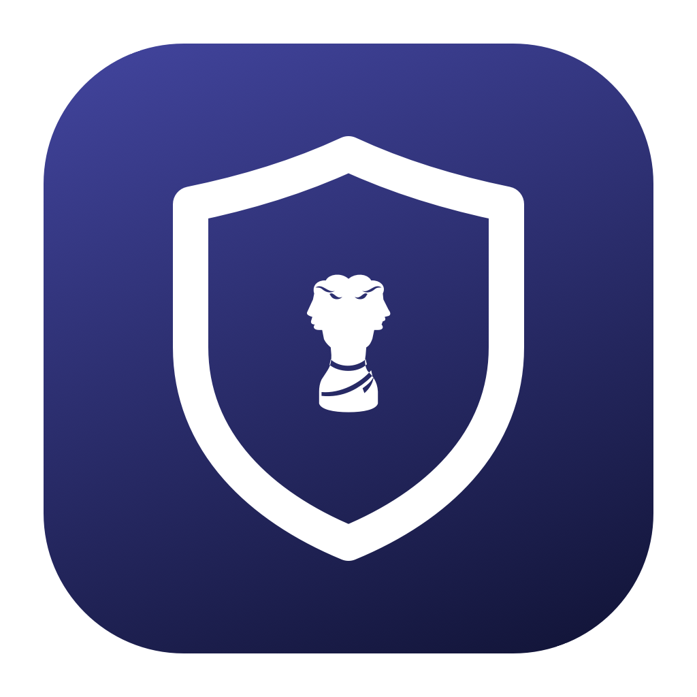

[English](README.md) | [简体中文](README-ZH.md)



# Janus Confidential CLI

通过原生身份验证，统一管理 SSH 主机、MySQL 数据库、远程 AI Agent 与已接入的 Agent CLI 账户。

- **Janus Confidential CLI 不保存任何密码，密码仅安全存放在 macOS 钥匙串中。** 设备配置只包含连接信息。
- **更安全地管理 Agent CLI 账户。** 密码在 Janus 原生窗口输入，无需在 AI 对话中提供；通过钥匙串保存和授权会话使用，大幅降低凭据泄漏风险。
- **主连接验证一次，后续会话复用。** 已有主连接时不重复读取密码。
- **停止复用，保留工作。** `disconnect` 不打断已建立的终端会话。
- **支持 A2X Agent。** 支持所有遵循 [A2X 协议规范](https://github.com/leo1394/A2X)的 Agent。

## 环境要求

macOS 14+（Apple Silicon 或 Intel）、系统 OpenSSH，以及可显示密码和身份验证窗口的图形登录会话。

## 安装

通过 Homebrew 安装，无需本地编译：

```sh
brew tap leo1394/janus
brew install leo1394/janus/janus
```

也可以使用独立安装器，无需 Homebrew。在项目目录运行：

```sh
./install.sh --prefix "$HOME/.local"
export PATH="$HOME/.local/bin:$PATH"
export MANPATH="$HOME/.local/share/man:${MANPATH:-}"
```

安装器下载并校验匹配的安装包；可通过 `--version X.Y.Z` 指定版本。

## 第一次连接

准备可达的 SSH 主机及支持密码登录的账户：

```sh
janus spawn builder@example.com -p 3233
# 在原生窗口确认主机密钥、输入密码。
# 退出远端 Shell 后，主连接仍可复用。
janus devices
janus rename builder@example.com 'Build Server'
janus connect 'Build Server'
```

列表字段为 `ID NAME PLATFORM TYPE CONNECTED READY`。SSH 行显示
`PLATFORM=terminal`、`TYPE=ssh`，`terminal` 不是命令或别名。
可复用主连接存在时，两列状态均为绿色 `✔︎`；确认失败显示红色 `✘`，未知显示 `-`。
JSON 使用布尔值或 null，不含颜色。

## AI Agent 连接

远端需运行 Agenux 服务：

```sh
janus spawn agent user@example.com -p 7263
janus connect agent-device-name
janus connect agent-device-name --empty
# 使用系统 SSH 接入时：
janus spawn agent user@example.com -p 22 --agent-transport stdio
```

新建 Agent 设备默认使用 `subsystem`；需要 stdio 时显式指定 `--agent-transport stdio`。运行 `janus spawn agent TERMINAL_ID` 或 `janus spawn agent TERMINAL_NAME` 可指定已有 SSH 终端，省略目标则通过选择器选择；非 terminal 类型会报错。选中后复用账户、主机和端口；已登记的对应 Agent 直接走 connect 流程。已有设备沿用保存的连接方式。

`connect` 根据设备类型自动选择连接方式；`--empty` 新建 Agent 会话。
支持交互终端的实例可直接进入 Agent 界面，任务型实例通过本机连接服务调用。
Agent 设备显示为 `PLATFORM=a2x`，类型由远端服务确认。

服务端要求双因素验证时，在原生窗口输入 6 位验证码，验证码不保存。
默认不共享本机 MCP 工具，仅通过 `--share-mcp` 显式允许的工具可用。
机器调用可使用 `janus agent info|status|send`，结果以 JSON 输出。
具体能力取决于远端 Agent 服务。

## 命令

<table>
<tr><th width="320">命令</th><th>用途</th></tr>
<tr><td><code>devices&nbsp;[--list|--json]</code></td><td>列出设备；默认表格，执行有时限的网络探测</td></tr>
<tr><td><code>spawn&nbsp;USER@HOST&nbsp;[-p&nbsp;PORT]</code></td><td>登记新设备，或连接已有设备</td></tr>
<tr><td><code>spawn&nbsp;mysql&nbsp;USER@HOST</code></td><td>登记 MySQL 目标与账户，验证 TLS 后进入 SQL 会话</td></tr>
<tr><td><code>spawn&nbsp;agent&nbsp;USER@HOST</code></td><td>登记并连接远程 Agent</td></tr>
<tr><td><code>connect&nbsp;[ID|NAME]&nbsp;[--empty]</code></td><td>连接 SSH、MySQL 或 Agent；缺省进入设备选择器</td></tr>
<tr><td><code>disconnect&nbsp;[ID|NAME&nbsp;...]</code></td><td>停止主连接复用，保留活动 session；缺省进入选择器</td></tr>
<tr><td><code>bridge&nbsp;[ID|NAME]</code></td><td>通过逐行 JSON 为桌面客户端桥接已认证的 A2X/Pi 会话；缺省目标时列出 Agent 设备</td></tr>
<tr><td><code>remove&nbsp;[ID|NAME&nbsp;...]</code></td><td>缺省时多选设备或账户；拒绝同名歧义及删除被引用账户；删除 MySQL 设备仍保留账户</td></tr>
<tr><td><code>credential&nbsp;--recover&nbsp;ID|NAME</code></td><td>通过原生窗口验证并切换 SSH 或 MySQL 凭据，保留旧条目</td></tr>
<tr><td><code>credential&nbsp;[--json]</code></td><td>列出账户；--edit 验证并更换密码，--remove 删除未被设备引用的账户</td></tr>
<tr><td><code>session&nbsp;list|close|revoke</code></td><td>查看或终止受管理的 MySQL 会话</td></tr>
<tr><td><code>rename&nbsp;ID|NAME&nbsp;NEW_NAME</code></td><td>修改名称；名称忽略大小写判重，必须唯一</td></tr>
<tr><td><code>help&nbsp;[command]</code>、<code>--help</code></td><td>无需初始化设备即可查看帮助</td></tr>
<tr><td><code>version</code>、<code>--version</code></td><td>显示版本号与编译日期</td></tr>
<tr><td><code>upgrade&nbsp;[--yes]</code></td><td>检查稳定版本，更新归属明确的安装</td></tr>
</table>

`upgrade` 不会在非交互环境静默批准更新，也不会隐式降级；Homebrew 安装继续由对应
Formula 管理。独立安装校验发布包后统一更新 CLI、助手、手册和补全；手动安装的 `PREFIX/bin/janus` 可补建安装记录。源码构建需要重新构建。

## 使用说明

新增 Agent 时发现当前 SSH 用户可访问的实例：唯一实例直接连接，多个实例显示选择器。`--instance NAME` 指定固定路由，失败不回退。自动发现需要服务端部署相应支持；已保存设备继续使用其绑定实例。

- SSH 密码仅保存在 macOS 钥匙串，不写入配置或日志；当前支持密码登录。
- 凭据失效时，使用 `janus credential --recover ID|NAME` 重新登记，验证成功后切换并保留旧条目。
- `disconnect` 和 `remove` 支持多个设备及多选器；单项失败不影响其他设备，活动终端会话保留。
- Agent 设备与恢复后的凭据记录需要 0.1.6 或更新版本。
- 安装包含 Shell 补全和 `man janus`；更多命令用法见 `janus help`。


## MySQL

```sh
janus spawn mysql reader@db.example.com -p 3306 --database analytics --ca /path/to/ca.pem
janus connect DEVICE
janus credential --json
janus credential --recover ACCOUNT
janus session list
janus session close SESSION_ID
```

密码仅在原生窗口输入并保存在钥匙串。TLS 默认验证服务器，省略 `--ca` 时使用系统信任。
每个 SQL 会话使用独立连接；以分号结束 SQL，以 `\q` 退出，结果输出为 JSON。
`disconnect` 保留已有事务，但禁止新会话；`session close/revoke` 终止指定 SQL 会话。
删除 MySQL 设备保留账户；账户不再被设备引用后，可用 `credential --remove ACCOUNT` 删除。
更换密码验证成功后撤销该账户原有 SQL 会话。网站登录与 Agent SQL 委派暂不支持。

## Agent CLI 账户

```sh
janus credential --add clobotics --environment test --username USER --json
clobotics auth login --confidential --resource ACCOUNT_ID
```

已接入的 Agent CLI 通过 Janus 请求原生授权，无需在 AI 对话中索取密码。
密码保存在钥匙串，token 由 Janus 进程持有，CLI 使用授权会话。
当前 Clobotics 接入支持身份检查、授权复用和会话撤销；业务 API 需另行接入。

接入方式见 [Agent CLI 对接规范](docs/cli-integration-ZH.md)。

## 设备画像

`janus profile [ID|NAME]` 查看缓存画像，不发起连接；`--refresh` 通过授权连接刷新，`--json` 输出结构化数据。
连接后采集 SSH 系统与资源、A2X 声明的 Agent 能力及 MySQL 可见数据库、各库表与视图目录和注释。
MySQL 字段与索引详情按需使用 `--database NAME [--table NAME] --refresh` 获取，不读取业务行或凭据。
Agent 未返回的模型信息保持未知。

## 开发

源码构建需要 Go 1.22+（或当前 macOS 要求的更新版本）与带 Swift 的 Xcode Command Line Tools。

```sh
go test ./...
make build
./build/bin/janus --help
```

本地构建可通过 `./install.sh --local build --prefix "$HOME/.local"` 安装。
目前已在 Apple Silicon 上验证；Intel 和其他支持的 macOS 版本尚未完成实机验收。

## 协议

项目采用 Apache License 2.0，见 [LICENSE](LICENSE)。第三方代码保留原有许可声明。

MySQL 不支持 TLS 时，可显式使用 `spawn mysql USER@HOST --tls disabled`；此连接未加密，原生窗口会提示，不会自动降级。

账户 ID 使用 `janusacc-xxxx-xxxx-xxxx-xxxxxxxxxxxx`，总长 36 字符，后缀为随机十六进制字符；设备与账户 ID 联合检查唯一性。旧账户 ID 仍可用于查找，原钥匙串映射保持不变。未被设备引用的账户可通过 `janus remove ACCOUNT_ID` 或 `janus credential --remove ACCOUNT_ID` 删除。
