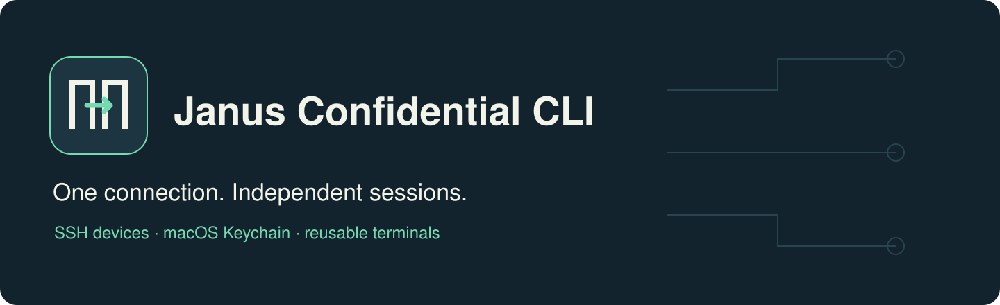

[English](README.md) | [简体中文](README-ZH.md)




# Janus

Manage SSH devices, keep passwords in macOS Keychain, and open independent terminal sessions through one authenticated connection.

- **Authenticate once per master.** Later sessions reuse the live SSH master.
- **Stop reuse without breaking work.** `disconnect` preserves established sessions.
- **Keep credentials out of configuration.** Device JSON contains metadata only.
- **A focused base CLI.** Extracted from Janus Confidential; prepared for future device and authorization extensions.

## Requirements and release status

macOS 14+ on Apple Silicon or Intel, system OpenSSH, and a graphical login session
for native password/identity dialogs. Source builds require Go 1.22+ (or a newer
version required by your macOS) and Xcode Command Line Tools with Swift.
Current validation is on Apple Silicon only; Intel and older supported macOS
versions remain unverified. The installer does not establish older OS compatibility.

Builds read the version from `VERSION.txt` and use the build date. Setting a stable
version does not publish a release. Official native releases are Developer ID signed
and notarized before publication. Precompiled distribution currently targets Apple Silicon;
Intel remains a source-build target without additional platform acceptance.

## Build and install now

From this checkout:

```sh
make build
./build/bin/janus version
./install.sh --local build --prefix "$HOME/.local"
export PATH="$HOME/.local/bin:$PATH"
export MANPATH="$HOME/.local/share/man:${MANPATH:-}"
```

Builds only this project's Go CLI and native Keychain helper, never a Janus
Confidential product. `install.sh` works independently of Homebrew and stages
verified resources before replacing the executable. It restores replaced files
on failure; the multi-file installation is not an atomic transaction.

Install the stable release with Homebrew (no local compilation):

```sh
brew tap leo1394/janus
brew install leo1394/janus/janus
```

The standalone installer also supports `./install.sh --version X.Y.Z --prefix DIR`
using matching GitHub Release assets and checksums. Availability is determined by
the published release for the requested version and architecture.

## First connection

You need an SSH account that accepts password authentication and a reachable host:

```sh
janus spawn builder@example.com -p 3233
# Confirm the host key and enter the password in native UI.
# Exit the remote shell to return here; the master stays reusable.
janus devices
janus rename builder@example.com 'Build Server'
janus connect 'Build Server'
```

The table contains `ID NAME PLATFORM TYPE CONNECTED READY`. SSH rows have
`PLATFORM=terminal`, `TYPE=ssh`; `terminal` is not a command or alias. A live,
reusable master shows green `✔︎` in both status columns. Confirmed failure is red
`✘`, unknown is `-`; JSON uses booleans/null and no colour.

## Commands

| Command | Purpose |
| --- | --- |
| `devices [--list\|--json]` | List saved devices; default table, bounded network probes |
| `spawn USER@HOST [-p PORT]` | Register a new device or connect to an existing one |
| `connect [ID\|NAME]` | Open a session; no argument opens the selector |
| `disconnect [ID\|NAME ...]` | Stop master reuse; keep existing sessions; no argument opens the selector |
| `remove [ID\|NAME ...]` | Select a device when omitted; delete metadata and the exact Keychain credential; leave connections running |
| `rename ID\|NAME NEW_NAME` | Change the unique, case-insensitive display name |
| `help [command]`, `--help` | Help without application initialization |
| `version`, `--version` | Exact two-line build metadata |
| `upgrade [--yes]` | Check stable releases and update an owned installation |

`upgrade` never silently approves non-interactive updates or downgrades. It
respects Homebrew ownership; source builds need a rebuild. Development builds
are explicitly reported rather than treated as stable releases.

## Completion and manuals

Both installation paths deploy Bash, Zsh and Fish completion and `man janus`.
For standalone installation, activate the shell you use:

```sh
# Bash 3.2+ (self-contained)
source "$HOME/.local/share/bash-completion/completions/janus"
# Zsh: before your existing compinit invocation
fpath=("$HOME/.local/share/zsh/site-functions" $fpath)
autoload -Uz compinit && compinit
# Fish (fish syntax)
source ~/.local/share/fish/vendor_completions.d/janus.fish
```

With Homebrew, follow its shell-completion setup if your shell does not already
load its completion directories. Dynamic device completion reads saved metadata
only; pressing Tab never starts a service, reads a password or makes a download.

## Boundaries

Passwords are transient in native memory only and persisted in the login
Keychain. Master reuse is an SSH authentication optimization, **not Agent
authorization**. This base runtime uses user-private OpenSSH sockets; it does not
implement Confidential's native process proofs or Agent admission controls.

Existing Confidential/Workbench clients and records are not automatically
migrated. A future adapter must use one shared runtime owner. Saved credentials
with an incompatible legacy identity offer native, explicit enrollment of a
separate base-Janus credential. Enter the SSH password in that window; recovery
preserves the old entry. Existing base credentials are never overwritten by this
recovery. Stable release signing remains necessary for seamless upgrades. Password rejection
requires updating the exact item in Keychain Access. Key-only authentication,
arbitrary SSH options, Android/iOS/MySQL and the Confidential commands are outside
this build. A failed first login leaves the saved device available for retry.

The <3-second dialog and <1-second reused-session values are **acceptance targets,
not measured guarantees**. See [architecture](docs/architecture.md),
[extraction record](docs/provenance.md), [validation](docs/validation.md) and
[release checklist](docs/releases.md).

## Development

Run `go test ./...` and `make build`; no formatter is required. Add behavior tests
for lifecycle changes, maintain the shared command/help/completion contract, and
keep both READMEs aligned. See [LICENSE](LICENSE) and preserved source notices.

`disconnect` and `remove` accept multiple IDs/names. With no arguments, use
the multi-select picker (Space toggles, Enter confirms). Matching devices are
processed once; unmatched arguments and failures do not stop other operations.
The final summary highlights counts on terminals (respects `NO_COLOR`). Partial
failure returns a nonzero exit status after completion. Active sessions survive.
